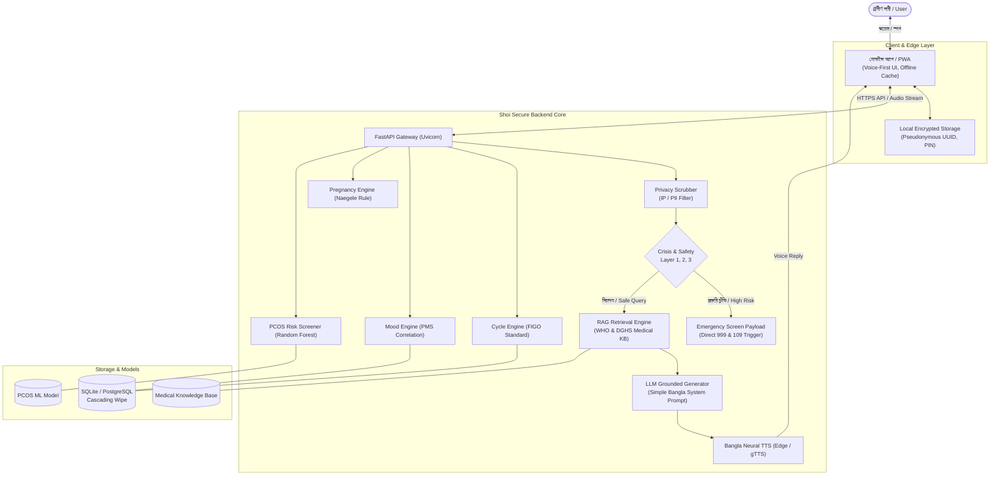

# Shoi (সই) — System Architecture

Shoi is an end-to-end, privacy-preserving AI voice and text health assistant designed for menstrual health, maternal care, and mental wellness among women in Bangladesh.

## Security & Privacy Guarantees
1. **Zero PII Policy:** No name, email, phone number, village, or IP address is ever collected, stored, or recorded in server logs.
2. **Pseudonymous UUID:** Every user is identified solely by a client-generated or server-generated random v4 UUID.
3. **Audio Destruction:** Raw voice recordings are processed in temporary memory or ephemeral storage and destroyed immediately following transcription.
4. **Cascade Deletion:** A single tap on "আমার সব তথ্য মুছে ফেলুন" deletes the user record and cascades immediate deletion across all period logs, mood logs, and checks.
